## 0.准备文件夹

一级文件夹  分到的图片开始的序号

	二级文件夹 文件夹名字为pic 里面为你分到的图片

	二级文件夹 文件夹名字为txt

```text
分到的图片序号
├─pic
└─txt
```

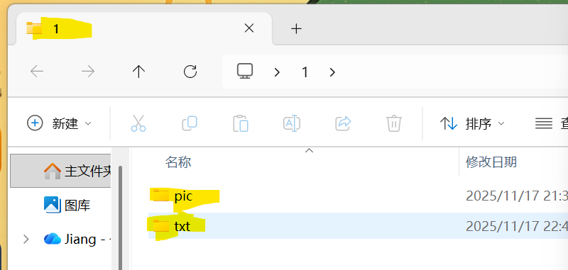

---

## 1.下载 labelimg.exe

如果下载不了注意关闭防火墙，或者在windows安全中心中选择保留。

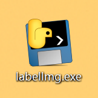

---

## 2.双击图标

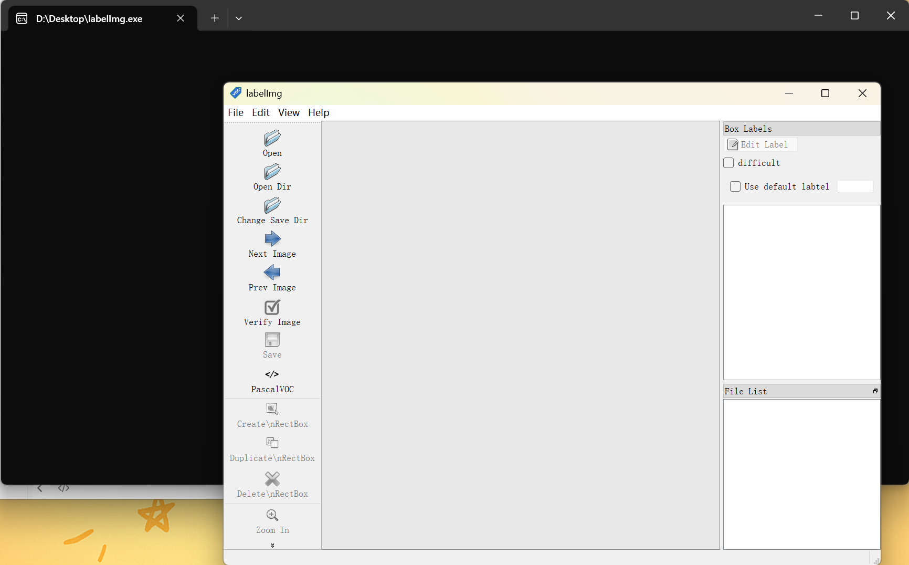

注意不要关掉这个黑色的终端

---

## 3.界面说明

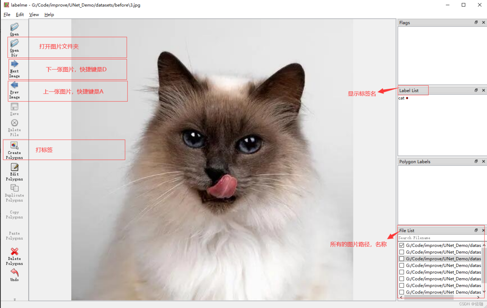

---

## 4.开启自动保存

点击View--Auto Save mode

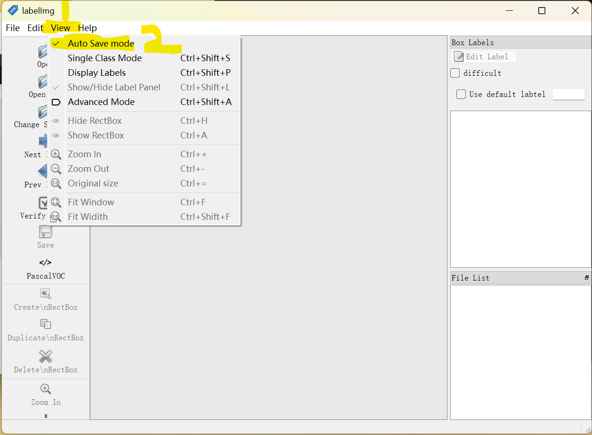

---

## 5.打开文件夹

打开文件夹路径为 分到的图片序号/pic

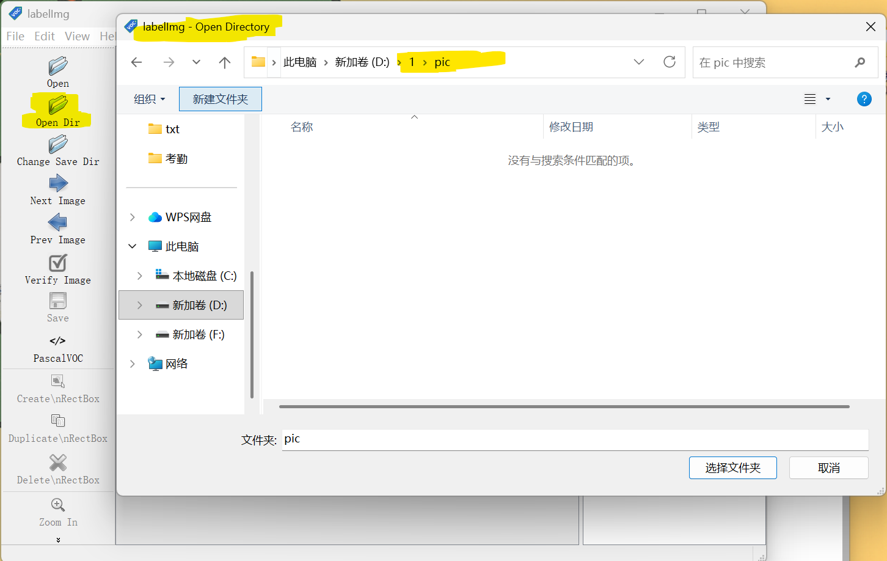

## 6.保存文件夹

保存文件夹路径为 `分到的图片序号/txt`

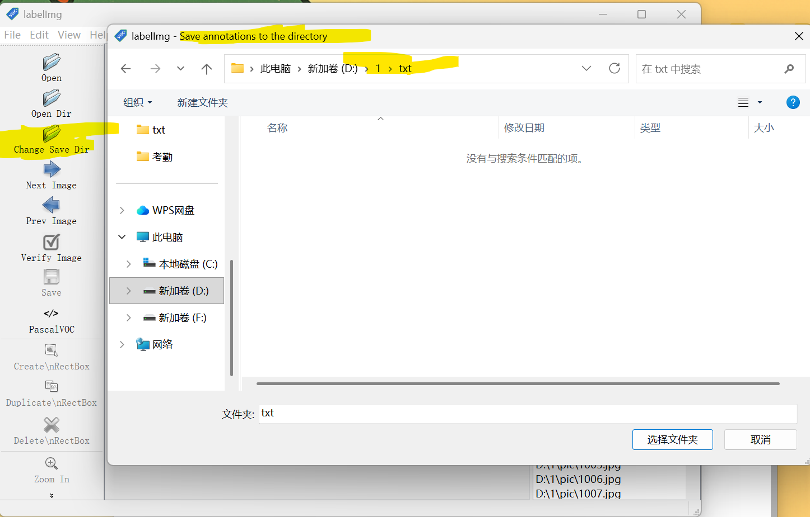

## 7.转为yolo 这一步非常非常重要

点击一下这个PascalVOC


变为yolo格式

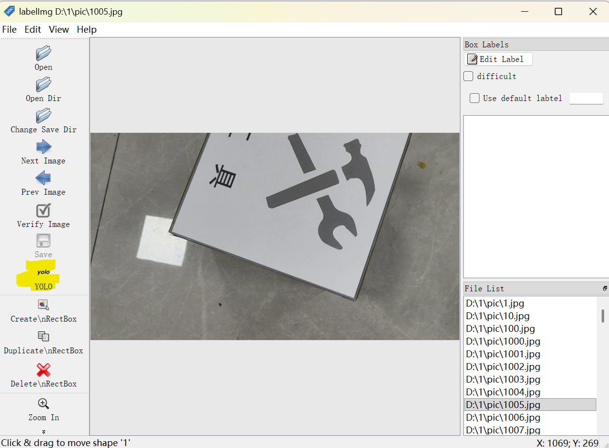

## 8.开始标注

#### 0 首先输入法要在英文输入状态

#### 1 因为我们有四个标签

所以不管图像是什么，我们都要先按照顺序标出四个假标签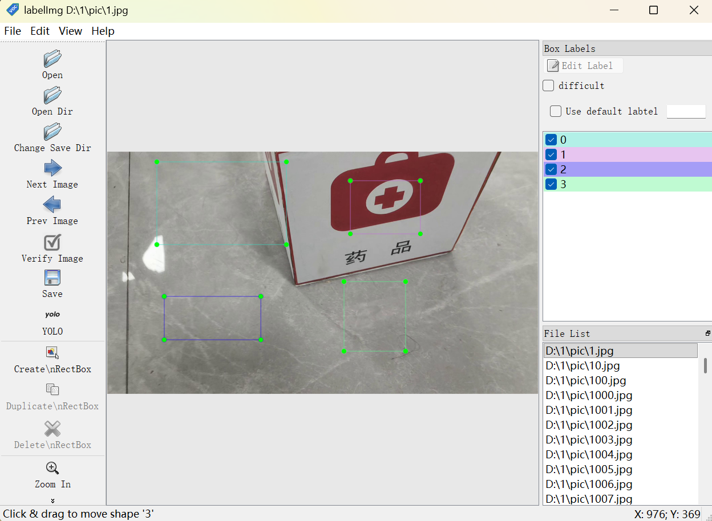

保存

然后打开 开始序号\txt\classes.txt  检查是不是有四个

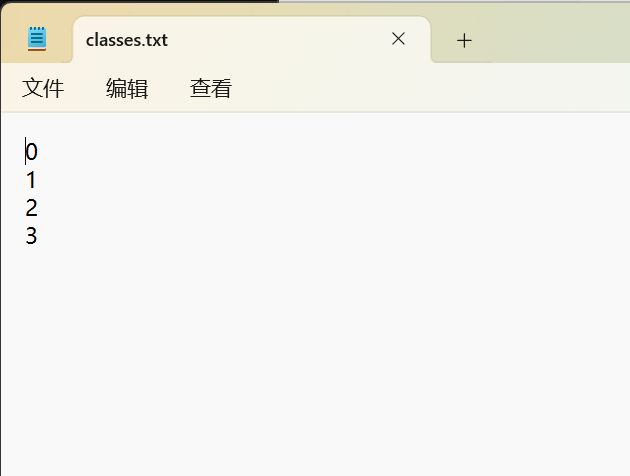

然后删掉我们刚刚的四个假标签 鼠标放在框框上右键

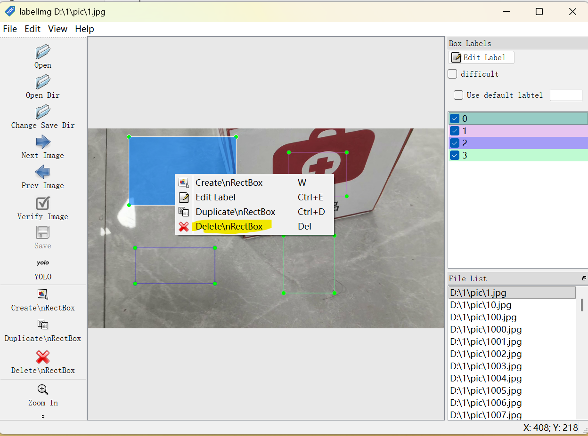

删掉后正常标注

标注完后再检查txt是不是我们需要的数字

#### 2 画标记

按下w快捷键  或者 图中标黄的Create

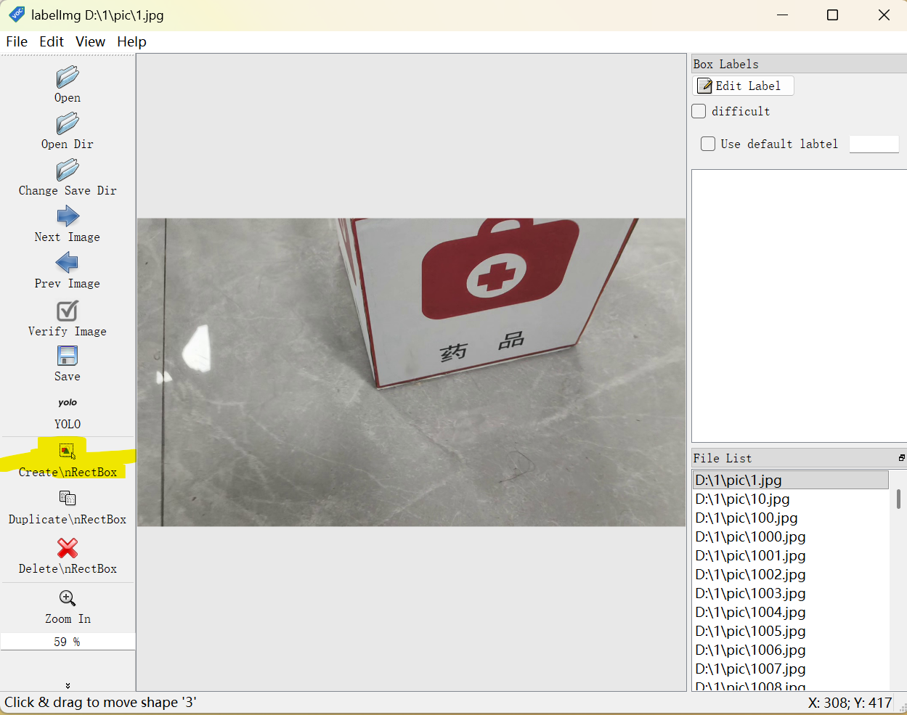

然后在物体左上角按住鼠标左键 长按鼠标左键 到物体右下角松开

标注尽量”相切“图形

你能分得清的就标出框框，自己分不清的可以先随便标注一个然后保存后再删除标签再保存

#### 3 标签说明

**注意** **标签！！！！！**

**食品箱是0**

**工具箱是1**

**仪器箱是2**

**药品箱是3**

**食品箱是0**

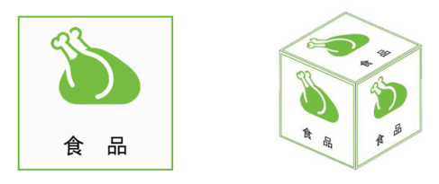

**工具箱是1**


**仪器箱是2**

**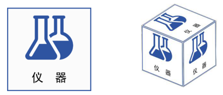**

**药品箱是3**

****

#### 4 保存

自动保存或者ctrl + s

#### 5 下一张

英文状态下按下快捷键D 或者 点击界面中Next Image

## 9 全部完成

文件目录为

```bash
分到的图片序号
├─pic
└─txt
```

其中txt文件夹为

其中classes.txt为

然后将主文件夹以压缩包形式发给我们

命名：图片开始的序号.zip
