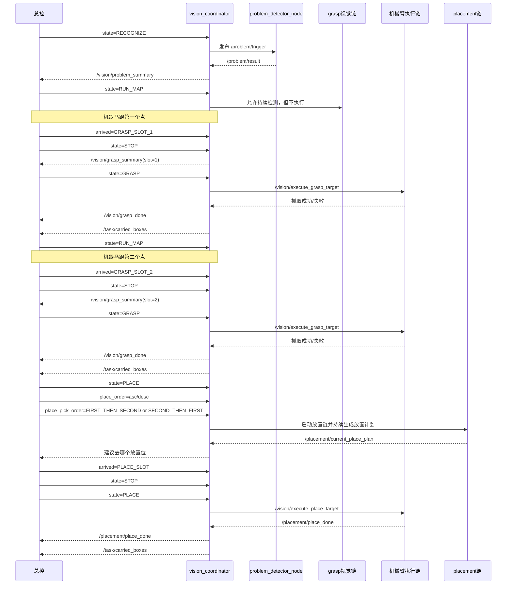
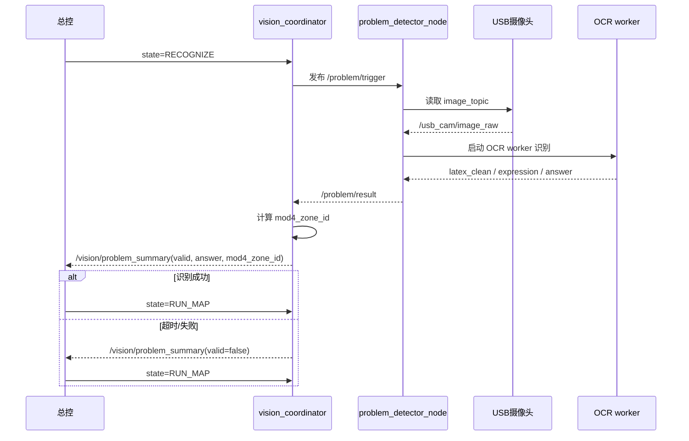
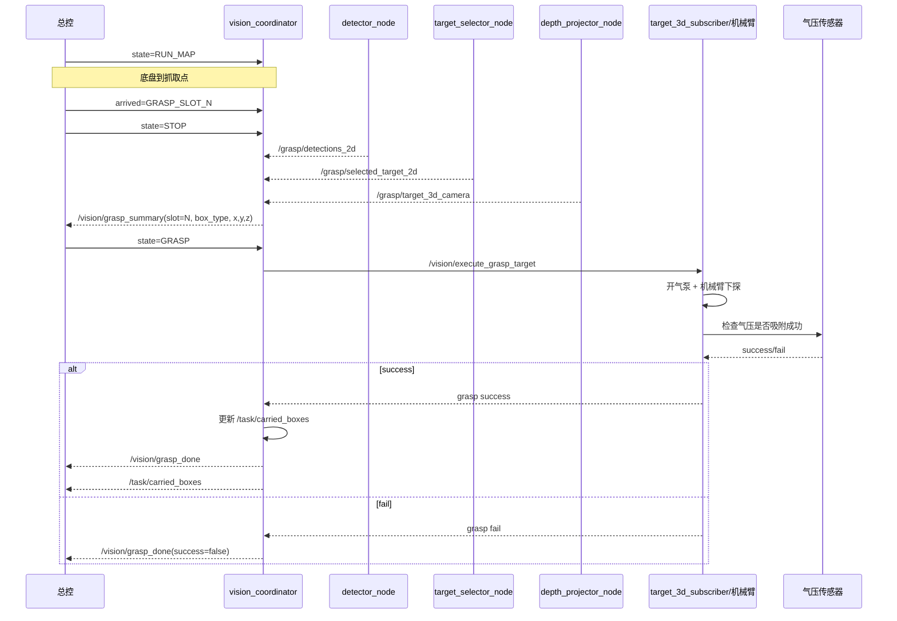
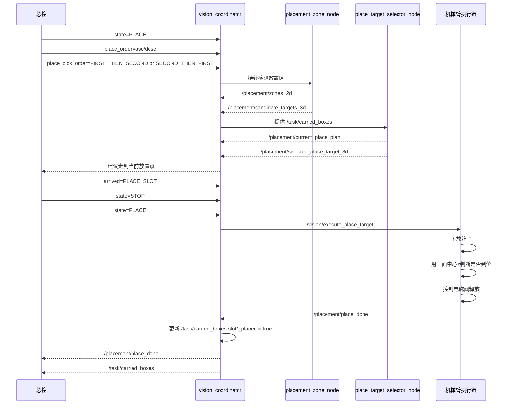

我们再整理一遍工作流。

总控是有五个状态，识别状态，跑图状态，停止状态，抓取状态，放置状态。

我们视觉是有五条链路

- 题目识别与表达式链路
- 物品种类yolo识别箱子种类链路
- D435i末端抓取反馈链路
- 放置区放置箱子链路
- 机械臂控制与气泵控制

开始时先缓启动题目识别模型，当正式开始时总控会给我们发一条信息，启动题目**识别链路**，输出答案。

识别成功之后，总控宣布进入**跑图状态**，启动yolo识别链路和D435i机械臂末端反馈链路。让yolo模型开始识别。我们的比赛策略是机器马通过激光雷达可以实现走点位，我们的路径已经写死了。机器马先到达第一个点位，到达点位后，总控发送**“停止”指令**，总控发送“抓取”指令，总控宣布进入**抓取状态**，<u>气泵启动</u>，yolo识别并记录箱子种类和位置，画出识别出的正方形箱子debug图、中心点(x,y)、然后通过深度相机获取相对于摄像头的(x,y,z)，控制机械臂吸起来第一个箱子。先抓左边，当机械臂去往下吸起的时候，摄像头的视野看不见整个箱子，我们通过~~整个画面中心的z的深度~~ -- 气压传感器来判断是否已经抓取成功。如果抓取成功，给总控发送“已抓取”的指令，总控宣布进入跑图状态，然后控制吸盘头旋转至吸盘的第一个位置。

然后机器狗走到第二个箱子的点位，到达点位后，总控发送**“停止”指令**，总控发送“抓取”指令，yolo识别并记录箱子种类和位置，控制机械臂吸起来第二个箱子。然后给总控发送“已抓取”的指令。进入跑图状态，然后控制吸盘头旋转至吸盘的第二个位置。这样就拿了两个箱子。一会也是放两个箱子，所以我们要有一个消息接口记录拿到箱子的种类。

抓取到两个箱子或者机械狗走到放置区之后，总控会宣布切换至**放置状态**。启动放置区放置箱子链路，机器马会从放置区的最右边走向最左边或者从放置区的最右边走向最左边。因为机器马走的方向是固定的。所以放置箱子的编号要么就是0、1、2、3，要么就是3、2、1、0。然后根据机器马现在的方向，以及已经抓取的箱子，告诉总控怎么走，走多远。然后走过放置区的时候摄像头一直水平朝下会识别到放置区的颜色，从而知道放置区的种类、画出识别出的放置区的正方形debug图、中心点(x,y)、然后通过深度相机获取相对于摄像头的(x,y,z)。~~然后当识别到地面放置区和我拿的箱子的编号相同的箱子一样时，给主控发消息，让机械马停止，~~

机器马走到点位后，机器狗停下。让机械臂放下对应的箱子，我们通过整个画面中心的z的深度来判断是否已经放置到位。放置到位后控制电磁阀，放下箱子。总控会给我们发到底是0,1,2,3还是3,2,1,0。如果是前者就是编号小的箱子先放，如果是后者就是编号大的先放。用·ros发放是第一次抓取的箱子先放还是第二次抓取的箱子先放。因为机器马的路径是定死的，所以我们高分箱子没有优先级。

我现在五条链路其实都各自写好了，但是没有统一起来。我需要你帮我理一下思路。告诉我，我需要总控哪些信息，总控需要我的哪些信息。以及我收到总控的消息后，应该怎么去处理。

请重新给我们生成几个时序图，总控的时序图，题目识别时序图，单次抓取时序图，放置时序图

## 1）总控总时序图

---

## 2）题目识别时序图

这个图是和你当前代码一致的，因为现在 `problem_recognition_run_detector.sh` 默认就把 `image_topic` 指到 `/usb_cam/image_raw`。

---

## 3）单次抓取时序图

---

## 4）放置时序图

## 1. 识别阶段

### 总控发

- `state = RECOGNIZE`

### 视觉做

- 跑 USB 题目识别
- 发布 `/vision/problem_summary`

---

## 2. 抓取阶段，第一个箱子

### 总控发

- `state = RUN_MAP`
- 到第一个点位后：
  - `state = STOP`
  - `current_grasp_slot = 1`
  - `state = GRASP`

### 视觉做

- 用 D435i 固定俯视识别箱子
- 成功抓到后发布：
  - `/vision/grasp_done(success=true, carried_slot=1, box_type=...)`
  - 更新 `/task/carried_boxes.slot1_*`

这时总控就知道：

- 第一个箱子的种类是什么

---

## 3. 抓取阶段，第二个箱子

### 总控发

- 到第二个点位后：
  - `state = STOP`
  - `current_grasp_slot = 2`
  - `state = GRASP`

### 视觉做

- 成功抓到后发布：
  - `/vision/grasp_done(success=true, carried_slot=2, box_type=...)`
  - 更新 `/task/carried_boxes.slot2_*`

这时总控就知道：

- 第二个箱子的种类是什么

---

## 4. 放置阶段

### 总控发

- `state = PLACE`
- `place_order = asc / desc`
- 先放 `slot1` 还是 `slot2`
- 到放置位后发：
  - `arrived = PLACE_SLOT`

### 视觉做

- 启动放置链
- 结合：
  - `CarriedBoxState`
  - `place_order`
  - 当前看到的放置区
- 放下箱子

### 总控做

- 生成 `current_place_plan`
- 决定当前先放 `slot1` 还是 `slot2`
- 然后让机械臂执行对应放置

这里你们现在的统一思路是：

**视觉负责“看见并规划”，总控负责“最终执行次序决策”。**

这个思路没问题。
